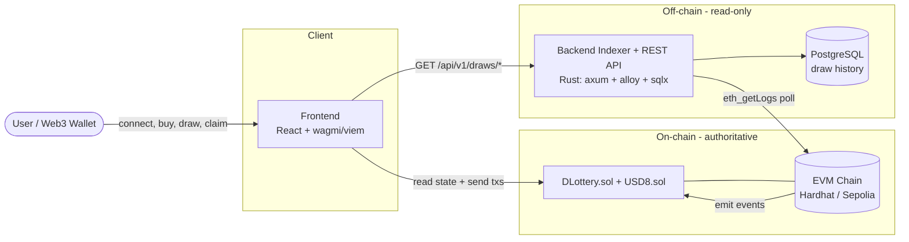
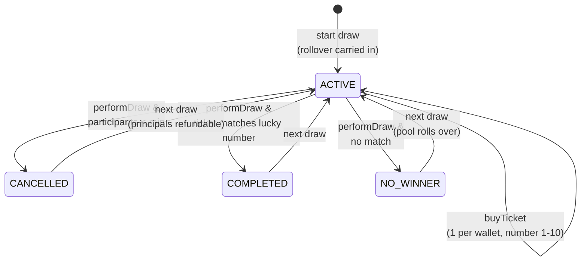
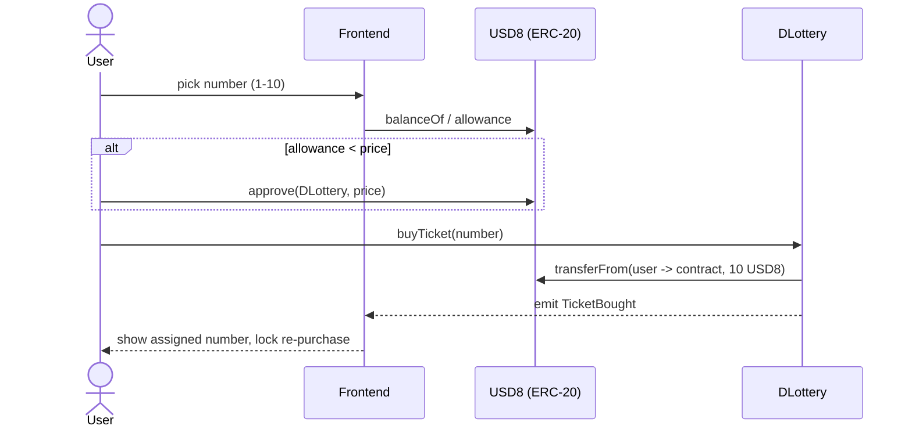
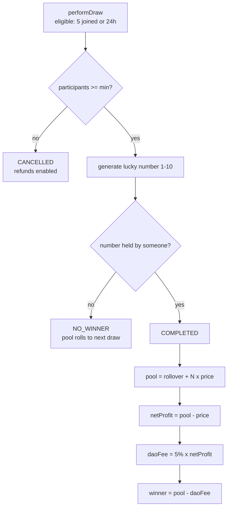

# DLottery - Decentralized Lottery (MVP)

A full implementation of the **DLottery** PRD (v1.1): a decentralized lottery on an
EVM-compatible blockchain where users buy numbered tickets with the **USD8** token and every
draw settles on-chain. The repository contains all three components plus a one-command local
stack.

| Component     | Tech                                   | Directory    |
| ------------- | -------------------------------------- | ------------ |
| Smart contract| Solidity 0.8.28 + Hardhat              | `contracts/` |
| Backend       | Rust (axum, sqlx, alloy) + Postgres    | `backend/`   |
| Frontend      | React + Vite + wagmi/viem              | `frontend/`  |

> The smart contract is the authoritative source of all lottery and financial state. The
> backend is a **passive** indexer - it never determines results or controls funds.

## Architecture



The frontend reads **live** draw state straight from the contract and fetches **history**
from the backend. The backend only indexes events into Postgres - it never controls funds.

## Draw lifecycle (state machine - PRD 5.1)



## Ticket purchase flow (PRD 4.3 / 5.2)



## Settlement & economics (PRD 5.4-5.6)



## Core rules (PRD 1.3)

Payment token USD8 · ticket price 10 USD8 · max 5 participants · numbers 1-10 · one ticket
per wallet · 24-hour draws · configurable minimum · draw triggers at 5 participants or
timeout · below minimum ⇒ cancelled + refunds · winner matches the lucky number · no winner
⇒ rollover · DAO fee = 5% of the winner's net profit.

### Economics (PRD 5.4-5.6)

```
P_total      = rollover + participants × ticketPrice
Net Profit   = P_total − ticketPrice          (winner principal excluded)
DAO Fee      = Net Profit × 5%
Winner Prize = P_total − DAO Fee
```

Worked example - rollover 20, 5 players, price 10 ⇒ pool **70**, DAO fee **3**, winner **67**
(asserted in `contracts/test/DLottery.test.ts`).

## Quick start - full stack with Docker

```bash
docker compose up --build
```

This starts:

- **chain** - a Hardhat node on `:8545` with USD8 + DLottery auto-deployed at deterministic
  addresses, seeding several test accounts with USD8.
- **postgres** - on `:5432`.
- **backend** - indexer + REST API on `:8080`.
- **frontend** - served on `http://localhost:5173`.

Point a Web3 wallet (e.g. MetaMask) at **chain id 31337 / http://localhost:8545**, import a
Hardhat test account private key, and play. Try the API directly:

```bash
curl http://localhost:8080/api/v1/draws/current
curl "http://localhost:8080/api/v1/draws/history?page=1&page_size=10"
```

Deterministic addresses on a fresh node: USD8 `0x5FbDB231…80aa3`, DLottery `0xe7f1725E…0512`.

## Manual / dev workflow

```bash
# 1. Contracts - compile, test, run a node, deploy
cd contracts
npm install
npm test                         # 26 tests covering SC-01..26 + worked example
npm run node                     # terminal A: local chain on :8545
npm run deploy:localhost         # terminal B: deploy + write deployments/ + export ABIs

# 2. Backend (needs Rust 1.90+, Postgres, and the RPC above; or just use Docker)
cd ../backend
cp .env.example .env             # set CONTRACT_ADDRESS from the deploy output
cargo run --release

# 3. Frontend
cd ../frontend
cp .env.example .env             # set addresses + VITE_BACKEND_URL
npm install && npm run dev       # http://localhost:5173
```

## Live testnet deployment (Sepolia)

The contracts are deployed and verified-working on the **Sepolia** testnet (chain `11155111`):

| Contract  | Address |
| --------- | ------- |
| USD8      | [`0x433f594eA97219bE1e01be4050B63AFDAA6b4F9b`](https://sepolia.etherscan.io/address/0x433f594eA97219bE1e01be4050B63AFDAA6b4F9b) |
| DLottery  | [`0xB8f3f30C26588a9914a575A3e9105F57F6D7BA95`](https://sepolia.etherscan.io/address/0xB8f3f30C26588a9914a575A3e9105F57F6D7BA95) |

Run the stack against Sepolia:

```bash
# Backend indexer + Postgres pointed at the live Sepolia contract
docker compose -f docker-compose.sepolia.yml up --build

# Frontend (frontend/.env already points at Sepolia)
cd frontend && npm run dev
```

Then switch MetaMask to the **Sepolia** network and connect. Deploy it yourself with your
own key via `cd contracts && npm run deploy:sepolia` (see `contracts/.env.example`).

## Draw lifecycle (PRD 5.1)

```
Start new draw (rollover carried in) → ACTIVE (buy tickets)
  → [5 joined or 24h] → minimum met?
       no  → CANCELLED (refunds) → Refund claimed
       yes → READY TO DRAW → ticket matches lucky number?
                yes → COMPLETED (winner claims prize)
                no  → NO_WINNER (pool rolls into next draw)
```

## Requirements traceability

Every requirement id (SC/BE/FE) and PRD section is mapped to code in
[`TRACEABILITY.md`](./TRACEABILITY.md).

## Repository layout

```
contracts/   Hardhat project: USD8.sol, DLottery.sol, tests, deploy/export scripts, Dockerfile
backend/     Rust indexer + REST API, SQL migrations, Dockerfile
frontend/    React dApp (wallet, dashboard, purchase, draw, results, refunds, history)
docker-compose.yml   chain + postgres + backend + frontend
TRACEABILITY.md      requirement → code matrix
```

## Security note on randomness

The MVP lucky number uses on-chain entropy (`block.prevrandao` + draw salt). This is fine for
a testnet MVP but is **manipulable by block proposers**. A production deployment must replace
`DLottery._generateLuckyNumber` with a verifiable randomness source (e.g. Chainlink VRF). This
is documented at the top of `contracts/contracts/DLottery.sol`.
